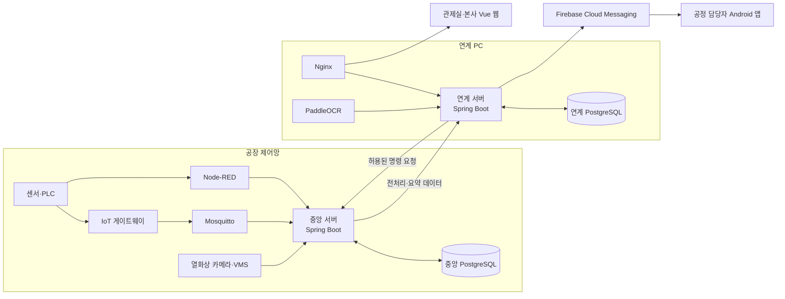

# ArgOS

> 현대자동차 울산공장을 가정하여 현장 위험을 감지하고, 단계별 경보와 대응 이력을 통합 관리하는 환경안전 관제 시뮬레이션 프로젝트

## 1. 프로젝트 개요와 추진 배경

| 항목 | 내용 |
| --- | --- |
| 프로젝트명 | ArgOS (환경안전 통합관제 시스템) |
| 팀명 | Golden Time Ever |
| 수행 기간 | 2026.11.11 ~ 2026.11.24 |
| 팀 구성 | 5명 |
| 수행 과정 | 현대오토에버 SFASS 부트캠프 최종 프로젝트 |
| 적용 대상 | 현대자동차 울산공장을 가정한 환경안전 관제 시뮬레이션 |
| 주요 위험 | 화재, CO 가스, 전류·온도 이상 등 |

자동차 공장은 다수의 공정과 설비가 동시에 가동되며, 센서·PLC·열화상 카메라 등에서 발생하는 데이터를 빠르게 해석하고 현장 담당자에게 전달해야 합니다. ArgOS는 이러한 데이터를 하나의 흐름으로 연결하여 다음 업무를 지원하는 것을 목표로 합니다.

- 공장·공정·설비별 안전 상태 통합 조회
- 전류·온도·CO 등 환경안전 데이터의 실시간 감시
- 정상·주의·경보의 단계별 위험 판단 및 알림
- 담당자 체크리스트 전송과 조치 결과 기록
- 알람·점검·문서·기준값 변경 이력 관리

> 이 저장소의 문서는 최신 시스템 아키텍처, 최신 DB 설계, 최신 화면설계안, 최초 수행계획서 순서로 내용을 반영합니다. 자료 간 충돌하거나 물리 구현 방식이 확정되지 않은 내용은 [확인 필요 사항](#확인-필요-사항)에 별도로 기록합니다.

## 2. 주요 목표와 차별화 요소

### 주요 목표

1. **현장 위험의 조기 인지**  
   센서값과 열화상 정보를 이용해 위험 징후를 빠르게 확인합니다.
2. **단계별 대응 표준화**  
   정상·주의·경보 상태와 체크리스트를 연결해 담당자가 동일한 절차로 대응하도록 지원합니다.
3. **대응 과정의 추적성 확보**  
   발생, 확인, 담당자 배정, 체크리스트 수행, 조치 완료까지의 이력을 남깁니다.
4. **제어망 원본 데이터 보호**  
   원본 센서값·열화상 원본·PLC 로그는 공장 중앙 서버 내부에 보관하고, 연계 PC에는 허용된 전처리·요약 데이터만 전달하는 구조를 지향합니다.
5. **다공장 확장 기반 마련**  
   사업장-공장-공정-설비-센서 계층을 기준으로 데이터를 구성하여 향후 다른 공장으로 확장할 수 있도록 설계합니다.

### 차별화 방향

- 현장 감지에서 알림, 체크리스트, 조치 확인까지 하나의 업무 흐름으로 연결
- 공장 제어망과 사용자 서비스 영역을 중앙 서버와 연계 PC로 분리
- 관제실·본사 웹과 공정 담당자 Android 앱의 역할을 구분하면서 Vue 코드를 가능한 범위에서 공유
- 설비·센서별 기준값과 변경 이력을 관리하여 경보 판단 근거를 추적

## 3. 핵심 기능

아래 항목은 최신 화면설계안과 DB 설계를 기준으로 정리한 **설계 범위**입니다. 구현 완료 여부는 기능별로 별도 검증해야 합니다.

### 3.1 통합 관제 대시보드

- 사업장 지도에서 울산·아산·전주 등 사업장 상태 조회
- 사업장 → 공장 → 공정 → 설비 순서의 화면 이동
- 정상·주의·경보·화재 상태별 색상 표시
- 공장·공정별 센서 및 알림 건수 요약
- 실시간 알림 목록과 시간대별 알림 현황 표시

### 3.2 설비 및 센서 상세 모니터링

- 전류, 온도, CO 센서 현재값 조회
- 최근 구간의 센서 추이와 주의·경보 기준 비교
- 열화상 카메라 이미지 또는 이벤트 시점 스냅샷 조회
- 공정·설비 배치도에서 설비와 연결 센서 위치 확인
- 설비 운전 상태, 센서 연결 상태, 담당자 정보 조회

### 3.3 단계별 경보와 대응

- 1단계 정상, 2단계 주의, 3단계 경보 상태 판단
- 경보 발생 위치, 센서값, 기준값, 발생 시각 표시
- 관제 사용자의 경보 확인 및 담당자 재배정
- 공정 담당자 앱으로 체크리스트 전송
- 체크리스트 진행률, 현장 메모, 완료 시각, 확인자 기록
- 경보·조치·명령 전달 결과 이력 관리

> 설비 셧다운, 경고 방송 등 안전 관련 제어는 허용된 명령만 중앙 서버가 검증하여 처리하는 설계입니다. 실제 장비 환경에서 구현·검증되지 않은 자동 제어를 완성 기능으로 간주하지 않습니다.

### 3.4 화재 대응

- 열화상 최고 온도와 센서 상태를 함께 확인
- 화재 이벤트 위치와 감지 근거 표시
- 경고 방송, 본사 통보, 설비 정지 등 대응 상태 기록
- 해제 권한과 해제 이력 관리

### 3.5 통계·이력 관리

- 기간, 공장, 공정, 센서 종류, 경보 등급별 조회
- 일별 알림 추이, 공정별 알림, 요일·시간대별 발생 현황
- 평균 조치 시간과 체크리스트 완료율 조회
- 알림 이력과 조치 상태 조회 및 내보내기 기능 검토

### 3.6 점검 및 문서 관리

- 설비별 점검 일정과 담당자 관리
- 수기 안전 문서 업로드 및 OCR 인식 결과 검수
- 문서 양식별 인식 항목과 신뢰도 관리
- 점검 결과, 첨부 파일, 검수자, 완료 이력 저장

### 3.7 기준값 관리

- 설비에 연결된 센서별 주의·경보 기준값 설정
- 연속 초과 샘플 수, 변화율, 적용 기간, 계절 조건 관리
- 변경 전·후 값, 변경자, 변경 시각, 변경 사유 기록
- 기준값 변경 전 예상 알림 영향 확인 기능 검토

### 3.8 사용자·권한 및 운영 관리

- 본사 관리자, 공장 관리자, 공정 담당자 역할 관리
- 사용자별 사업장·공장·공정 담당 범위 지정
- 사용자 등록, 수정, 사용 정지, 비밀번호 초기화
- 로그인 이력과 주요 관리 작업의 활동 로그 조회
- 설비 담당자와 주 담당자 지정

### 3.9 현장 협업

- 점검 일정 또는 경보를 기준으로 메시지 연결
- 사용자별 마지막 읽은 메시지 관리
- 웹과 모바일 간 현장 메모 공유 기능 검토

## 4. 기술 스택

| 영역 | 기술 | 용도 |
| --- | --- | --- |
| 공장 중앙 서버 | Spring Boot 3, Java 17 | 수집 데이터 처리, 위험 판단, 이벤트·경보, 허용 명령 처리 |
| 연계 서버 | Spring Boot 3, Java 17 | 화면 API, 인증·권한, 통계·이력, 문서·알림 서비스 |
| 데이터베이스 | PostgreSQL 16 × 2 | 중앙 서버 DB와 연계 서버 DB의 논리·물리 분리 |
| 데이터 수집 | Node-RED | PLC 값 변환, 시뮬레이션, 데이터 흐름 구성 |
| 메시징 | Eclipse Mosquitto (MQTT) | 게이트웨이와 중앙 서버 사이의 센서 데이터 전달 |
| 현장 연동 | Modbus, OPC UA, RTSP, VMS REST API | 센서·PLC·열화상 연동 후보 |
| 웹 프론트엔드 | Vue 3, Vite, Pinia, ECharts | 관제실·본사 웹 화면 |
| 모바일 | Capacitor, Vue 3, Android | 공정 담당자 체크리스트·알림 앱 |
| 웹 배포 | Nginx, HTTPS, WSS | Vue 정적 파일 및 연계 서버 프록시 |
| 인증·권한 | Spring Security | 로그인과 역할·담당 범위 검증 |
| 실시간 통신 | REST API, WebSocket | 조회·관리 API와 실시간 상태 갱신 |
| 푸시 알림 | Firebase Cloud Messaging | 모바일 알림 전송 |
| 문서 인식 | PaddleOCR | 수기 문서 인식 설계 범위 |
| 로컬 개발 | Docker Compose | 로컬 서비스 구성 보조 |

## 5. 시스템 아키텍처 및 데이터 흐름



### 데이터 흐름 원칙

1. 센서·PLC·열화상 데이터는 공장 제어망에서 수집합니다.
2. 중앙 서버는 원본 데이터를 내부 DB 또는 내부 저장소에 보관하고 위험 상태를 판단합니다.
3. 연계 PC에는 화면 제공에 필요한 상태, 1분 추이, 임계값 초과 이벤트, 당시 열화상 이미지 등 허용된 데이터만 전달합니다.
4. 웹과 모바일 사용자는 중앙 서버가 아니라 연계 PC의 서버에 접속합니다.
5. 연계 서버의 명령 요청은 허용 목록과 권한을 검증한 뒤 중앙 서버로 전달합니다.
6. 중앙 서버는 명령 수행 결과를 연계 서버에 반환하고 양쪽 시스템에 추적 가능한 이력을 남깁니다.

> `docker-compose.yml`은 로컬 개발 편의를 위한 제안입니다. 하나의 개발 PC에서 컨테이너를 나누는 것은 실제 공장 제어망과 연계 PC의 물리적 망 분리를 구현한 것이 아닙니다.

## 6. 프로젝트 디렉터리 구조와 폴더별 역할

현재 프로젝트 코드가 생성되기 전의 **권장 구조**입니다. 아래 파일과 디렉터리는 실제 초기화 시 필요한 것만 순차적으로 생성합니다.

```text
ArgOS/
├── factory/
│   ├── central-server/                 # 공장 중앙 Spring Boot 서버
│   │   ├── src/main/java/.../factory/
│   │   │   ├── common/                 # 공통 응답·예외·시간 규칙
│   │   │   ├── config/                 # 보안·MQTT·DB 설정
│   │   │   ├── ingestion/              # 센서·PLC·VMS 입력 처리
│   │   │   ├── monitoring/             # 현재 상태·추이 집계
│   │   │   ├── alarm/                  # 임계값·경보 판단
│   │   │   ├── fire/                   # 화재 이벤트 처리
│   │   │   ├── control/                # 허용 명령 검증·실행
│   │   │   └── transfer/               # 연계 PC 전송 계약
│   │   ├── src/main/resources/
│   │   │   ├── application.yml
│   │   │   └── db/migration/           # Flyway 등 도구 확정 후 사용
│   │   └── src/test/
│   ├── node-red/
│   │   ├── flows/                      # 내보낸 Node-RED 플로우
│   │   ├── lib/                        # 공통 변환 함수
│   │   ├── credentials.example.json    # 비밀값 없는 예시
│   │   └── README.md
│   ├── mqtt/
│   │   ├── config/                     # Mosquitto 설정
│   │   ├── acl/                        # 토픽 접근 정책
│   │   └── certs/README.md              # 인증서 배치 안내만 커밋
│   └── db/
│       ├── migration/                   # 중앙 DB 스키마 변경
│       ├── seed/                        # 개발용 기준 데이터
│       └── README.md
├── gateway/
│   ├── backend/                        # 연계 PC Spring Boot 서버
│   │   ├── src/main/java/.../gateway/
│   │   │   ├── common/
│   │   │   ├── config/
│   │   │   ├── auth/                    # 로그인·권한·담당 범위
│   │   │   ├── dashboard/               # 화면 요약 조회
│   │   │   ├── alarm/                   # 경보 조회·확인·조치
│   │   │   ├── history/                 # 이력·통계
│   │   │   ├── inspection/              # 일정·체크리스트
│   │   │   ├── document/                # 파일·OCR 결과
│   │   │   ├── notification/            # WebSocket·FCM
│   │   │   ├── admin/                   # 사용자·공장·설비·기준값
│   │   │   └── integration/             # 중앙 서버 연계
│   │   ├── src/main/resources/
│   │   │   ├── application.yml
│   │   │   └── db/migration/
│   │   └── src/test/
│   ├── frontend/                       # Vue 웹 + Capacitor 공유 코드
│   │   ├── src/
│   │   │   ├── api/                     # 연계 서버 API 모듈
│   │   │   ├── assets/
│   │   │   ├── components/
│   │   │   ├── features/                # 도메인별 재사용 기능
│   │   │   ├── layouts/
│   │   │   ├── pages/                   # dashboard, alarm, history 등
│   │   │   ├── router/
│   │   │   ├── stores/                  # Pinia
│   │   │   ├── types/
│   │   │   └── utils/
│   │   ├── public/
│   │   ├── android/                     # Capacitor 생성 후 추적 여부 결정
│   │   └── capacitor.config.ts          # 모바일 적용 시 생성
│   ├── nginx/
│   │   ├── nginx.conf
│   │   ├── conf.d/
│   │   └── certs/README.md
│   └── db/
│       ├── migration/                   # 연계 DB 스키마 변경
│       ├── seed/
│       └── README.md
├── docs/
│   ├── architecture/                   # 구성도·데이터 흐름·ADR
│   ├── api/                            # OpenAPI·WebSocket·서버 간 계약
│   ├── db/                             # 논리 ERD·물리 ERD·테이블 정의서
│   ├── ui/                             # 화면 설계와 작업자 흐름
│   ├── operations/                     # 실행·장애 대응·데모 시나리오
│   └── decisions/                      # 주요 설계 결정 기록
├── .github/
│   ├── ISSUE_TEMPLATE/
│   ├── workflows/
│   └── pull_request_template.md
├── .env.example                        # 키 이름과 설명만 포함
├── .gitignore
├── README.md
└── docker-compose.yml                  # 로컬 개발용, 생성 예정
```

### 구조 설계 원칙

- 중앙 서버와 연계 서버는 각각 독립적으로 빌드·실행·테스트할 수 있게 구성합니다.
- DB 마이그레이션도 중앙 DB와 연계 DB 디렉터리로 분리합니다.
- 프론트엔드는 웹과 Android 앱이 API, 상태 관리, 공통 컴포넌트를 공유하도록 설계합니다.
- 인증서, 비밀번호, FCM 서비스 계정, 실제 접속 주소는 저장소에 커밋하지 않습니다.
- 생성되지 않은 빌드 파일과 설정 파일은 이 문서에서 예정 구조로만 제시합니다.

## 7. 중앙 서버와 연계 서버의 책임 구분

| 구분 | 공장 중앙 서버 | 연계 PC 서버 |
| --- | --- | --- |
| 주요 목적 | 현장 데이터 수집·판정·제어망 내부 처리 | 사용자 서비스·업무 지원 |
| 입력 | MQTT, Node-RED, PLC, VMS | 중앙 서버 요약 데이터, 웹·앱 요청 |
| 보관 | 원본 센서값, 원본 열화상, PLC·제어 로그 | 상태·1분 추이, 경보·조치, 사용자·문서·점검 데이터 |
| 판단 | 임계값, 지속 시간, 복합 조건, 화재 판단 | 화면 집계, 권한, 업무 상태 검증 |
| 명령 | 허용 목록 검증 후 현장 명령 수행 | 권한 검증 후 중앙 서버에 명령 요청 |
| 외부 접속 | 직접 사용자 접속 금지 원칙 | HTTPS/WSS를 통한 웹·앱 접속 창구 |
| 장애 시 원칙 | 연계 단절 시에도 현장 수집·판정 지속 | 중앙 연결 상태 표시, 재연결·중복 방지 처리 |

서버 간에는 데이터베이스를 직접 공유하지 않고, 합의된 API 또는 메시지 계약으로 통신하는 방식을 권장합니다.

## 8. 데이터베이스 구조 개요

최신 ERD는 PostgreSQL 기반의 **논리 통합 모델**로 총 30개 테이블을 제안합니다.

| 영역 | 테이블 | 역할 |
| --- | --- | --- |
| 사업장·설비 마스터 | `plant`, `factory`, `process`, `equipment`, `sensor` | 사업장-공장-공정-설비-센서 계층과 배치 정보 |
| 센서·판정 | `sensor_threshold`, `sensor_trend`, `sensor_event`, `sensor_event_sample`, `safety_grade` | 기준값, 1분 추이, 초과 이벤트와 이벤트 구간 샘플 |
| 경보·대응 | `alarm`, `alarm_action`, `fire_incident`, `equipment_command`, `file_asset` | 경보 상태, 조치, 화재, 명령, 파일 메타데이터 |
| 사용자·권한 | `role`, `app_user`, `user_assignment`, `login_history`, `activity_log`, `work_shift`, `equipment_manager` | 역할, 담당 범위, 접속·활동 이력, 설비 담당자 |
| 점검·문서 | `inspection_schedule`, `ocr_result`, `doc_form`, `checklist_template`, `checklist`, `checklist_item` | 점검 일정, OCR, 문서 양식, 경보 대응 체크리스트 |
| 협업 | `chat_message`, `chat_read` | 공장별 메시지와 사용자별 읽음 위치 |

### 저장 원칙

- 초 단위 원시 센서값은 중앙 서버 내부 보관 대상으로 봅니다.
- 화면용 장기 조회는 `sensor_trend`에 1분 평균·최소·최대·샘플 수를 저장하는 설계입니다.
- 임계값을 넘은 구간은 `sensor_event`와 `sensor_event_sample`로 별도 보존합니다.
- 파일 본문은 파일 저장소에 두고 DB에는 경로, 형식, 크기, 촬영·등록 시각 등 메타데이터를 저장합니다.
- 사용자·기준값·명령·경보 해제 등 주요 변경은 `activity_log` 또는 전용 이력 테이블로 추적합니다.

### 두 DB로의 물리 분리

현재 ERD는 하나의 논리 모델이며, 어떤 테이블을 중앙 DB와 연계 DB에 둘지는 최종 확정되지 않았습니다. 구현 전 아래 원칙으로 물리 ERD를 별도로 작성해야 합니다.

- 중앙 DB: 원본 수집, 센서 판정, 현장 이벤트, 제어 명령의 원본 기록 중심
- 연계 DB: 로그인·권한, 화면용 상태·추이, 경보·조치 사본, 체크리스트, 문서·OCR, 통계·협업 중심
- 두 DB 사이에는 외래키를 만들지 않고 안정적인 식별자와 동기화 시각을 사용
- 재전송 시 중복 저장되지 않도록 이벤트 ID와 멱등성 규칙 정의

## 9. 로컬 개발 환경 구성

### 권장 준비 항목

- JDK 17
- Node.js LTS 및 npm
- Docker Desktop 또는 동등한 컨테이너 실행 환경
- PostgreSQL 16
- Eclipse Mosquitto
- Node-RED
- Android Studio: Capacitor Android 앱 개발 시

### 로컬 구성 원칙

- 중앙 DB와 연계 DB는 서로 다른 데이터베이스와 계정을 사용합니다.
- 로컬 포트, 계정명, 데이터 경로는 `.env`에서 주입하고 `.env`는 커밋하지 않습니다.
- `.env.example`에는 실제 비밀값 없이 필요한 변수명과 설명만 작성합니다.
- 개발용 시뮬레이터 데이터와 실제 장비 연동 코드는 프로필 또는 어댑터로 구분합니다.
- 운영망의 IP, 인증서, 비밀번호, 토큰을 개발 저장소에 복사하지 않습니다.

## 10. 실행 방법

현재 저장소에는 Spring Boot, Vue, Node-RED, Docker Compose 설정 파일이 생성되지 않았습니다. 따라서 아래 명령은 프로젝트 초기화 후 사용할 수 있는 **예시**이며 확정 명령이 아닙니다.

### 중앙 서버 예시

```bash
cd factory/central-server
./gradlew bootRun
```

### 연계 서버 예시

```bash
cd gateway/backend
./gradlew bootRun
```

### Vue 개발 서버 예시

```bash
cd gateway/frontend
npm install
npm run dev
```

### Node-RED

1. `factory/node-red/flows/`에 검토된 플로우 JSON을 저장합니다.
2. 환경별 접속 주소와 자격 증명은 Node-RED credential 또는 환경변수로 주입합니다.
3. 실제 PLC 연결 전에는 시뮬레이터 프로필로 입력 형식과 경보 흐름을 검증합니다.

### Docker Compose 예시

```bash
docker compose up -d
```

`docker-compose.yml`을 실제로 작성한 뒤 서비스명, 포트, 볼륨, 헬스 체크를 이 문서에 확정해야 합니다.

## 11. GitHub 협업 규칙

### 브랜치 전략

| 브랜치 | 용도 |
| --- | --- |
| `main` | 안정화 및 최종 발표 버전 |
| `develop` | 기능 통합과 공동 테스트 |
| `feature/*` | 기능 단위 개발 |
| `fix/*` | 통합 중 발견된 버그 수정 |

### 작업 흐름

1. 작업 시작 전 이슈 또는 작업 항목에 담당 범위와 API 영향을 기록합니다.
2. `develop`에서 작업 브랜치를 생성합니다.
3. 자신의 담당 디렉터리 중심으로 변경하고 공통 계약 변경은 먼저 팀에 공유합니다.
4. Pull Request에 구현 내용, 테스트 결과, 화면 또는 API 변경 사항을 적습니다.
5. 최소 1명의 리뷰를 권장하며, 리뷰 후 `develop`에 병합합니다.
6. 발표 가능한 통합 버전만 `main`에 반영합니다.

### 커밋 메시지

Conventional Commits 형식을 사용합니다.

```text
feat: 센서 이벤트 조회 API 추가
fix: 경보 확인 중복 요청 방지
docs: 중앙-연계 서버 데이터 계약 정리
test: 임계값 지속시간 판정 테스트 추가
refactor: 대시보드 상태 집계 로직 분리
```

### 병렬 개발 원칙

- 중앙 서버, 연계 서버, 프론트엔드, 수집·DB 작업은 합의된 계약을 기준으로 병렬 진행합니다.
- API가 준비되기 전 프론트엔드는 `docs/api/`의 예시 응답을 사용합니다.
- DB 변경은 마이그레이션 파일과 테이블 정의서를 함께 수정합니다.
- 중앙-연계 계약 변경은 양쪽 담당자의 승인을 받은 뒤 반영합니다.
- 공용 enum, 시간 형식, 식별자 규칙은 각 코드에 임의 복제하지 않고 계약 문서로 관리합니다.

## 12. 팀원 역할

수행계획서의 역할 초안을 기준으로 하며, 중앙 서버와 연계 서버 분리 이후의 세부 담당은 팀에서 재확정해야 합니다.

| 팀원 | 기본 역할 | 주요 작업 디렉터리 | 브랜치 예시 |
| --- | --- | --- | --- |
| 이하연 | PM, 보고, 일정 관리, 산출물 취합 | `docs/`, `.github/` | `docs/project-plan`, `feature/integration-contract` |
| 윤수현 | DAS·DB, 데이터 처리·수집 | `factory/node-red/`, `factory/mqtt/`, `factory/db/` | `feature/factory-ingestion` |
| 이태인 | DAS·DB, DB 설계 | `factory/db/`, `gateway/db/`, `docs/db/` | `feature/db-schema` |
| 김재원 | Backend, Spring Boot·API | `factory/central-server/`, `gateway/backend/` | `feature/gateway-api`, `feature/central-alarm` |
| 조윤환 | Frontend, 관제 화면·시각화 | `gateway/frontend/` | `feature/frontend-dashboard`, `feature/mobile-checklist` |

> 한 명이 두 Spring Boot 서버를 모두 담당하게 되면 일정 위험이 커질 수 있습니다. 데이터 수집 또는 DB 담당자 중 1명이 중앙 서버의 수집 어댑터·이벤트 저장 영역을 함께 맡는 방식도 검토합니다.

## 13. 프로젝트 일정

| 구분 | 날짜 | 주요 목표 |
| --- | --- | --- |
| D1 | 11/11(수) | 프로젝트 기획, 요구사항 정의, 역할 분담 |
| D2 | 11/12(목) | 시스템·화면·DB·데이터 구조 설계 |
| D3 | 11/13(금) | 개발환경 구축, PLC·Node-RED 연동 검증 |
| D4 | 11/16(월) | 데이터 수집과 백엔드 API 개발 |
| D5 | 11/17(화) | 지도 기반 다공장 관제 화면 구현 |
| D6 | 11/18(수) | 중간보고와 핵심 기능 통합 점검 |
| D7 | 11/19(목) | 위험 판단·체크리스트·점검 흐름 구현 |
| D8 | 11/20(금) | 전체 기능 통합, 테스트, 핵심 개발 완료 목표 |
| D9 | 11/23(월) | 시연 영상, 발표자료, 최종 문서 작성 |
| D10 | 11/24(화) | 최종 발표와 프로젝트 제출 |

## 14. 향후 개선 사항

- 실제 PLC·센서·VMS 장비별 프로토콜 검증과 장애 복구 시험
- 중앙 서버와 연계 PC 사이의 인증, 암호화, 방화벽 정책 확정
- 네트워크 단절·재연결 시 데이터 유실 및 중복 방지 처리
- 화재 판단과 설비 셧다운의 안전 요구사항·수동 승인 절차 검증
- PaddleOCR 문서별 정확도 측정과 사람 검수 흐름 개선
- FCM 토큰 수명, 재발급, 다중 기기 정책 정비
- 장기 센서 데이터 보관 주기, 파티셔닝, 백업·복구 정책 수립
- 다공장 위험 패턴 비교와 선제 점검 권고 기능 고도화
- 운영 감사 로그의 위변조 방지와 보존 기간 정의

---

## 개발 시작 전 API 계약

### 중앙 서버 ↔ 연계 서버

| 계약 | 확정할 내용 |
| --- | --- |
| 상태 요약 | 사업장·공장·공정·설비 ID, 현재 상태, 마지막 수신 시각, 데이터 품질 |
| 센서 추이 | 센서 ID, 1분 구간, 평균·최소·최대·샘플 수, 단위 |
| 경보 이벤트 | 이벤트·경보 ID, 단계, 규칙, 시작·종료·최대값, 위치와 설비 정보 |
| 열화상 스냅샷 | 파일 ID, 촬영 시각, 최고 온도, 좌표, 접근 방식과 만료 정책 |
| 명령 요청 | 요청 ID, 설비 ID, 명령, 값, 요청자, 사유, 권한·승인 정보 |
| 명령 결과 | 요청 ID, 접수·수행·실패 상태, 수행 시각, 실패 코드와 상세 |
| 동기화 | 재시도 간격, 멱등성 키, 순서 보장, 누락 구간 재조회 방식 |

### 프론트엔드·모바일 ↔ 연계 서버

- 로그인, 로그아웃, 토큰 또는 세션 갱신 방식
- 사용자 역할과 담당 범위 응답 형식
- 사업장·공장·공정·설비 계층 조회
- 대시보드 상태와 WebSocket 구독 채널
- 경보 목록·상세·확인·해제·담당자 배정
- 체크리스트 전송·항목 완료·메모·결과 보고·최종 확인
- 점검 일정, 파일 업로드, OCR 인식·검수·저장
- 사용자·담당 범위·설비·센서·기준값 관리
- 통계 필터, 페이지네이션, 엑셀 내보내기 형식

### 공통 계약

- ID 형식과 시스템 간 전역 유일성
- 시간대 `Asia/Seoul`, 저장 시간 형식과 ISO 8601 표기
- 상태 enum: 정상·주의·경보·화재·통신두절·정지 등
- 공통 오류 응답, 오류 코드, 사용자 표시 메시지
- 목록 페이지네이션, 정렬, 필터 형식
- 파일 크기·형식·보관 기간·접근 권한
- API 버전, 호환성, 타임아웃, 재시도, 요청 추적 ID

## 환경변수 목록

아래는 변수명 초안입니다. 실제 값은 비밀 저장소 또는 배포 환경에서 주입합니다.

### 공통

```dotenv
TZ=Asia/Seoul
SPRING_PROFILES_ACTIVE=local
```

### 공장 중앙 서버

```dotenv
FACTORY_DB_URL=
FACTORY_DB_USERNAME=
FACTORY_DB_PASSWORD=
MQTT_BROKER_URL=
MQTT_USERNAME=
MQTT_PASSWORD=
MQTT_CLIENT_ID=
NODE_RED_BASE_URL=
VMS_BASE_URL=
VMS_API_TOKEN=
FACTORY_FILE_STORAGE_PATH=
GATEWAY_SERVER_BASE_URL=
GATEWAY_CLIENT_ID=
GATEWAY_CLIENT_SECRET=
CONTROL_COMMAND_ALLOWLIST=
```

### 연계 서버

```dotenv
GATEWAY_DB_URL=
GATEWAY_DB_USERNAME=
GATEWAY_DB_PASSWORD=
CENTRAL_SERVER_BASE_URL=
CENTRAL_CLIENT_ID=
CENTRAL_CLIENT_SECRET=
SECURITY_SECRET=
ALLOWED_ORIGINS=
FCM_CREDENTIALS_PATH=
OCR_SERVICE_URL=
GATEWAY_FILE_STORAGE_PATH=
```

### Vue·Capacitor·Nginx

```dotenv
VITE_API_BASE_URL=
VITE_WS_BASE_URL=
VITE_APP_MODE=web
NGINX_SERVER_NAME=
NGINX_TLS_CERT_PATH=
NGINX_TLS_KEY_PATH=
```

> 운영 비밀값, 인증서, `service-account.json`, Node-RED credential, 실제 `.env` 파일은 반드시 `.gitignore`에 포함합니다.

## 구현 범위 구분

| 구분 | 내용 |
| --- | --- |
| 확정된 설계 | 중앙 서버·연계 서버 분리, PostgreSQL 2개, Vue 웹·Capacitor 앱 방향, REST·WebSocket, Nginx, Spring Security |
| 시뮬레이션 우선 | PLC·센서 데이터, Node-RED 입력, 위험 시나리오, 단계별 경보, 열화상 이벤트 데이터 |
| 실제 연동 확인 필요 | PLC·OPC UA·Modbus, IoT 게이트웨이, MQTT 토픽, VMS API, 방송 설비, 설비 제어 |
| 설계 또는 향후 범위 | PaddleOCR 운영 적용, FCM 운영 배포, 자동 셧다운 검증, VPN·방화벽·물리 망 분리, 다공장 패턴 비교 |

## 확인 필요 사항

1. **논리 ERD의 물리 DB 분리 기준**  
   30개 테이블을 중앙 DB와 연계 DB에 어떻게 배치·복제할지 확정해야 합니다.
2. **중앙 서버와 연계 서버 간 통신 방식**  
   REST, 메시지 방식, 단방향 전송 주기, 재전송 정책, 인증 방식을 정해야 합니다.
3. **원본과 전처리 데이터의 경계**  
   화면에 필요한 현재값, 1분 추이, 이벤트 샘플, 열화상 파일 중 무엇을 연계 PC에 보낼지 확정해야 합니다.
4. **실제 장비 연동 범위**  
   PLC, 게이트웨이, MQTT, VMS, 방송 설비 중 실제 장비로 시연할 대상과 시뮬레이션 대상을 구분해야 합니다.
5. **제어 명령과 안전 절차**  
   `FAN_ON`, `SHUTDOWN` 등 허용 명령, 승인 권한, 실패 처리, 수동 복구 절차를 정해야 합니다.
6. **열화상 데이터 저장 방식**  
   원본 영상, 이벤트 이미지, 메타데이터의 보관 위치와 기간을 확정해야 합니다.
7. **인증 방식**  
   웹 세션 또는 토큰 방식, 모바일 갱신 방식, 서버 간 인증서 또는 자격 증명 방식을 정해야 합니다.
8. **OCR 실행 위치**  
   PaddleOCR를 연계 Spring Boot 프로세스와 함께 둘지 별도 서비스로 둘지 결정해야 합니다.
9. **프론트엔드 모바일 공유 범위**  
   웹 전체를 Capacitor로 감쌀지, 담당자 전용 화면만 공유할지 결정해야 합니다.
10. **배포·실행 파일**  
    Gradle 구성, Vue 패키지, Docker Compose가 아직 없으므로 실제 생성 후 실행 명령과 포트를 갱신해야 합니다.

